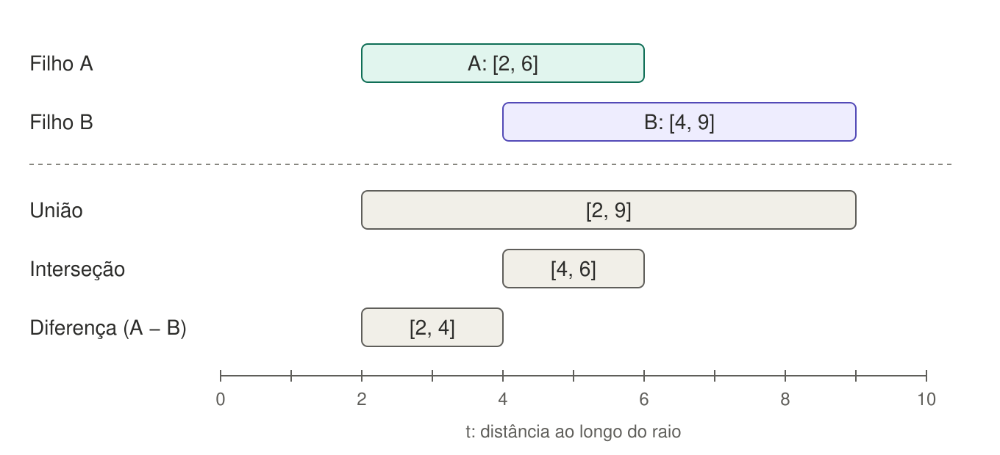
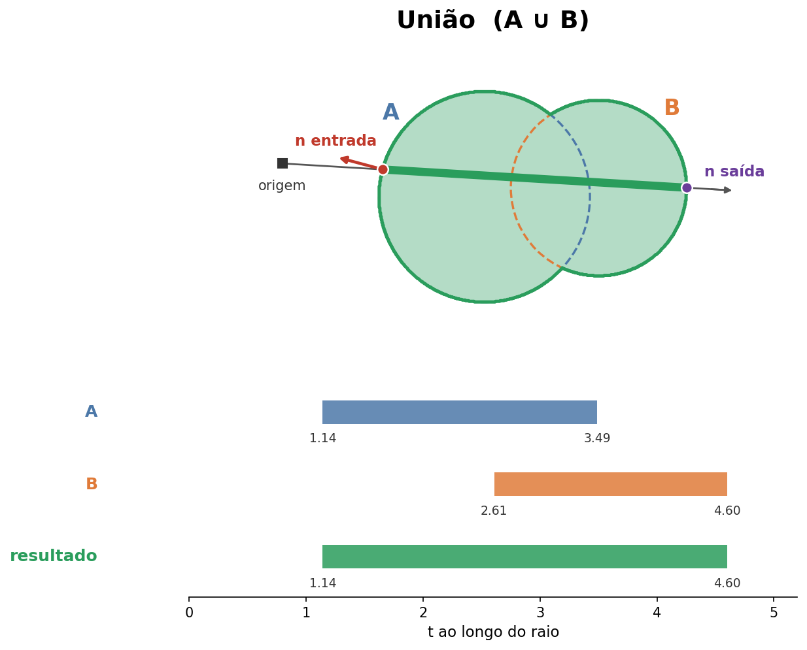
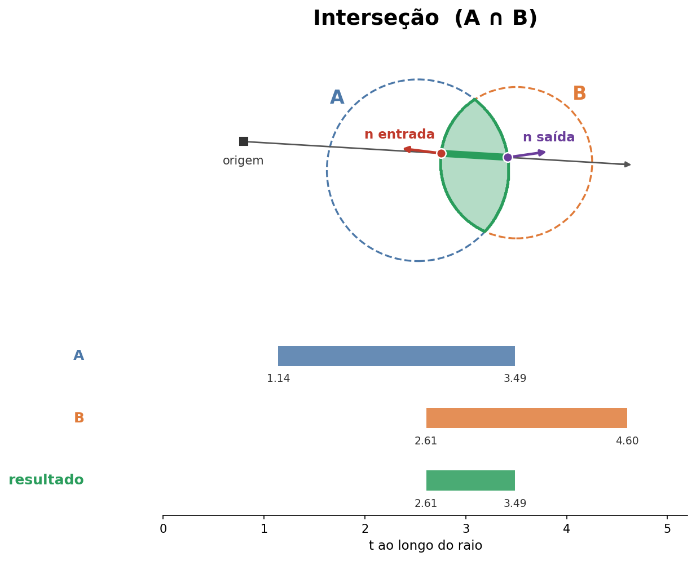
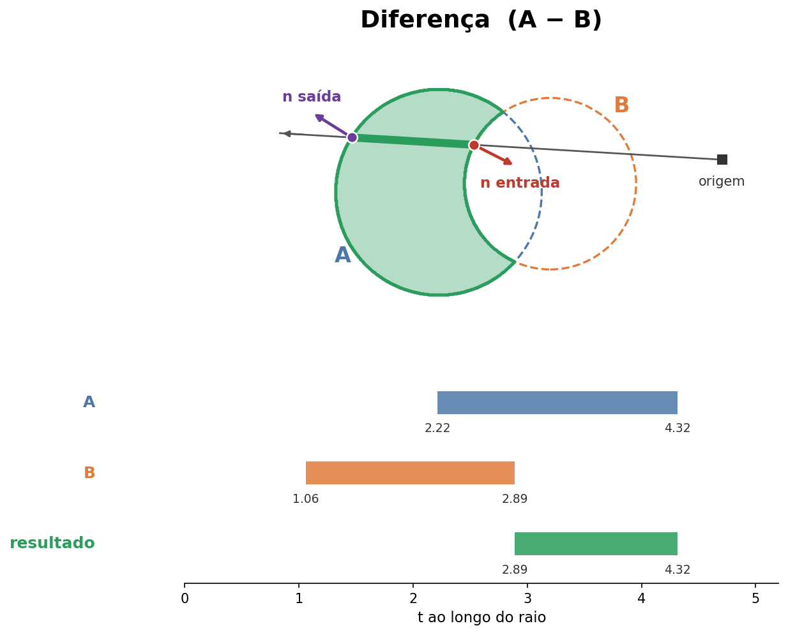
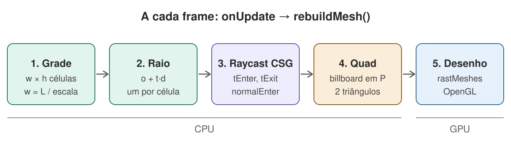
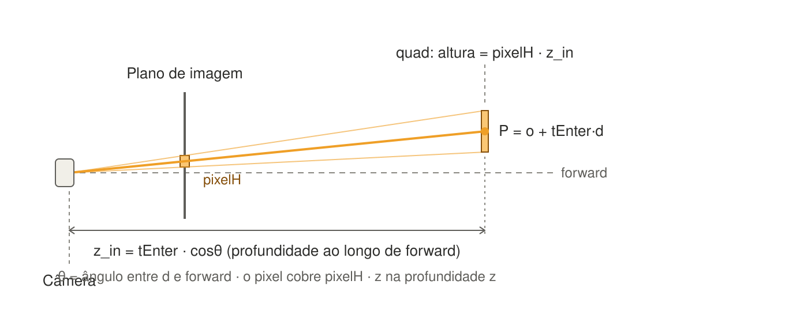

<!-- _class: lead -->
<!-- _paginate: false -->

# Modelador CSG com Raycast de Quads

Modelagem Geométrica — Trabalho 02
C++20 · GLFW · OpenGL · ImGui

---

## Roteiro

1. **CSG:** o sólido como árvore de primitivas e operações
2. **Raycast:** como um raio atravessa a árvore (álgebra de intervalos)
3. **Renderização:** como esses raios viram a imagem na tela
4. **Uso:** arquivo e interface
5. **Balanço:** decisões e limitações

---

<!-- header: "1 · CSG" -->

## O que é

Um modelador de sólidos por **CSG** que desenha **sem gerar malha do sólido**.

- O sólido é uma árvore binária: folhas são primitivas, nós internos são união, interseção e diferença
- A cada frame, a câmera lança raios contra a árvore e cada acerto vira um quad
- Dá para editar a árvore, mexer na câmera e salvar/abrir em texto

---

## Estrutura do código

| Módulo | O que faz |
|---|---|
| `csg.hpp` | Árvore CSG, pertinência, raycast, serializador e parser |
| `main.cpp` (`Trabalho02`) | Cena editável, UI, câmera, geração dos quads |
| `shape.hpp` | Esfera, bloco, cubo, cilindro, cone, cápsula, tetraedro |
| `Rot3f` / `Vec3f` | Rotação por quaternion |

`SceneNode` (modelo mutável da UI) → `buildCsg()` → `CsgNode` (árvore usada no cálculo).

---

## Árvore CSG

```cpp
using CsgPtr = std::unique_ptr<CsgNode>;
enum class CsgOp { Union, Intersection, Difference };

struct CsgPrimitive { std::unique_ptr<Shape> shape; Vec3f origin; Rot3f rotator; };
struct CsgOperation { CsgOp op; CsgPtr left; CsgPtr right; };   // Difference = left - right

class CsgNode { using Data = std::variant<CsgPrimitive, CsgOperation>; ... };
```

- Nó é um `variant` de folha ou operação, lido com `std::visit`
- `unique_ptr` para a posse; construção com `csgPrimitive`, `csgUnion`, `csgIntersection`, `csgDifference`

---

## Primitivas

Cada shape fica no **espaço local**, centrado na origem, com o eixo Y como eixo de revolução.

| Primitiva | Região |
|---|---|
| Esfera | $x^2+y^2+z^2 \le r^2$ |
| Bloco / Cubo | $\lvert x\rvert\le h_x,\ \lvert y\rvert\le h_y,\ \lvert z\rvert\le h_z$ |
| Cilindro | $x^2+z^2\le r^2$ e $\lvert y\rvert\le h/2$ |
| Cone | $(x^2+z^2)\,h^2 \le r^2(h/2-y)^2$ e $\lvert y\rvert\le h/2$ |
| Cápsula | distância ao segmento do eixo $\le r$ |
| Tetraedro regular | 4 semiespaços $n\cdot p \ge -s$ |

---

## `contains(p)`

1. Leva o ponto do mundo para o local: `(p - origin).rotated(q.conjugated())`
2. Testa a primitiva (`detail::inside`)
3. Nos nós internos, combina os filhos:

| Operação | Regra |
|---|---|
| União | `l \|\| r` |
| Interseção | `l && r` |
| Diferença | `l && !r` |

---

<!-- header: "2 · Raycast na árvore" -->

## Raycast: o raio vira lista de intervalos

Para um raio $o + t\,d$, cada nó devolve os intervalos de $t$ em que o raio está **dentro** do sólido:

```cpp
struct Interval { float t0, t1; Vec3f n0, n1; };  // entrada, saída e normais externas
using Intervals = std::vector<Interval>;          // ordenados e disjuntos
```

- Operações booleanas sobre intervalos dão intervalos, então a conta fecha
- `raycast()` pega o primeiro intervalo com $t_1>0$ e devolve um `RayHit` (`tEnter`, `tExit`, `normalEnter`)

---

## Primitivas como $At^2 + Bt + C \le 0$

```cpp
template <class Grad>
Intervals quadraticLE0(float A, float B, float C, Grad grad);
```

- `grad(t)` dá o gradiente no ponto de contato, que é a **normal externa**
- Trata caso linear ($A\approx 0$), discriminante negativo e intervalos infinitos
- Semiespaço é o caso $A=0$: bloco e tetraedro são interseção de semiespaços
- Cilindro = laje em Y ∩ cilindro infinito. Cone = laje ∩ cone duplo
- Cápsula = (laje ∩ cilindro) ∪ esfera de cada ponta

---

## Álgebra de intervalos

- **`unite`:** ordena por `t0` e funde o que se sobrepõe
- **`intersect`:** varredura com dois ponteiros; entra no maior `t0`, sai no menor `t1`
- **`subtract`:** recorta A pelos intervalos de B; onde a fronteira vem de B, a normal vira $-n_B$

```cpp
if (cut.t0 > cur.t0) out.push_back({cur.t0, cut.t0, cur.n0, cut.n0 * -1.0f});
cur.t0 = cut.t1;
cur.n0 = cut.n1 * -1.0f;
```

---

## Operações CSG sobre um raio



<span class="small">Cada folha devolve `[t0, t1]`; cada nó combina os intervalos dos filhos. O `t0` do resultado é o `tEnter` do quad. Valores ilustrativos.</span>

---



## Raycast na união

- Os intervalos de A e B se sobrepõem e viram **um só**
- Entra onde A entra (menor `t0`) e sai onde B sai (maior `t1`)
- As normais vêm de quem define cada ponta: entrada de A, saída de B

---



## Raycast na interseção

- Só sobra o trecho **comum** a A e B
- Entra no maior `t0` (entrada de B) e sai no menor `t1` (saída de A)
- A normal de cada ponta é a do shape que "manda" naquela ponta

---



## Raycast na diferença

- O trecho de B é **cortado** de A
- Sobra de A só o que vem antes de B: `[t0 de A, t0 de B]`
- Na ponta do corte a normal **inverte**: a saída do resultado usa $-n_B$ da entrada de B, apontando para dentro de B

---


## Raycast na diferença contrário

- Aqui o raio entra pelo lado de B, o objeto que subtrai
- B é cortado de A: o resultado começa onde B termina (`cur.t0 = cut.t1`)
- A normal de entrada é a saída de B invertida (`cut.n1 * -1`): aponta para dentro de B, que é o lado de fora do resultado
- A saída é a de A, sem mudança

---

## Por que cada shape guarda as normais de entrada e saída

Cada primitiva devolve `{t0, t1, n0, n1}`. A normal viaja junto com o `t` pela árvore.

- **Não dá para recalcular na raiz:** depois de combinar os nós só sobram `t0` e `t1`, e ninguém sabe qual primitiva definiu a fronteira
- **Entrada (`n0`):** vira `normalEnter` e é a `lightNormal` do quad
- **Saída (`n1`):** a álgebra precisa dela. Na diferença, a saída de B vira a entrada de A − B com sinal trocado (`cur.n0 = cut.n1 * -1`)
- Em união e interseção vence a normal de quem define o menor `t0` / maior `t1`

---

## Normal no ponto de contato, por shape

| Shape | Normal |
|---|---|
| Semiespaço (bloco, tetraedro) | $n$ constante |
| Esfera | $p - c$ |
| Cilindro (lateral) | $(x,\ 0,\ z)$ |
| Cone | $(x,\ m^2(h/2-y),\ z)$ |

- Com $t$ infinito, ou origem do raio já dentro, a normal é zero e o quad usa $-d$
- As normais voltam do local para o mundo junto com a rotação

---

## Transformações

- O raio vai para o espaço local: `(o - origin).rotated(inverse)` e `d.rotated(inverse)`
- A transformação é rígida, então **$t$ não muda** e os intervalos já valem no mundo
- As normais voltam ao mundo com a rotação direta
- A rotação é um quaternion (`Rot3f`); a UI edita em graus e `rotatorOf()` converte

---

<!-- header: "3 · Renderização" -->

## Como a imagem é produzida



- Não existe malha do sólido: a malha desenhada é **só a nuvem de quads** deste frame
- Tudo antes do passo 5 roda na CPU; a GPU só rasteriza os triângulos

---



## A ideia em um corte lateral

- A grade de pixels vira um leque de raios saindo da câmera
- Raio que **acerta**: vira um quad no ponto de entrada, perpendicular a `forward`
- Raio que **erra**: não gera nada (o fundo fica vazio)
- Os quads vizinhos se encostam, e juntos desenham a silhueta do sólido

---

## Passo 1 — Um raio por pixel

Grade reduzida: $w=\max(1,\lfloor L/s\rfloor)$ e $h=\max(1,\lfloor A/s\rfloor)$, com $s$ = escala de resolução (1 a 8, padrão 4).

Com $T=\tan(\text{fov}/2)$ e $a$ = aspecto, o centro do pixel $(x,y)$ no plano de imagem é

$$p_x=\Big(\tfrac{2(x+0.5)}{w}-1\Big)\,a\,T \qquad p_y=\Big(1-\tfrac{2(y+0.5)}{h}\Big)\,T$$

$$d=\frac{f+p_x\,r+p_y\,u}{\lVert f+p_x\,r+p_y\,u\rVert}$$

<span class="small">$f$, $r$, $u$ = `forward`, `right`, `up` da câmera. O raio parte sempre da posição da câmera. O $1-\dots$ em $p_y$ inverte o eixo: linhas de pixel crescem para baixo.</span>

---



## Passo 2 — Do acerto ao quad

1. `hit = csg->raycast(o, d)`; sem acerto, nada é gerado
2. Ponto de entrada: $P=o+t_{enter}\,d$
3. Profundidade: $z_{in}=t_{enter}\,(d\cdot f)$
4. Meio tamanho: $\tfrac12\,\text{pixelW}\,z_{in}$ e $\tfrac12\,\text{pixelH}\,z_{in}$
5. Cantos: $P \pm r\,h_w \pm u\,h_h$

<span class="small">Com $\text{pixelW}=2aT/w$ e $\text{pixelH}=2T/h$ (tamanho do pixel a profundidade 1).</span>

---

## Por que o tamanho é `pixel × z_in`

- Pela câmera pinhole, um pixel cobre `pixelH · z` de altura a uma profundidade $z$ (triângulos semelhantes)
- Usa-se $z$ ao longo de `forward`, e não $t$, porque o quad fica num plano **perpendicular a `forward`**
- Resultado: cada quad cobre **exatamente uma célula da grade** na tela, qualquer que seja a distância
- Por isso os quads de um raio e do vizinho se encostam, sem buracos em superfícies de frente para a câmera

---

## Passo 3 — Malha e desenho

- Por acerto: 4 vértices, 4 arestas e 2 triângulos, $(p_0,p_1,p_2)$ e $(p_0,p_2,p_3)$
- Os dois triângulos recebem a mesma `lightNormal`: a normal de entrada do raycast (ou $-d$ se for zero)
- **O quad diz *onde* está a superfície; a normal diz *como* ela é iluminada.** Por isso a luz sai suave mesmo com geometria feita de quadradinhos
- A caixa de limites do mundo é uma malha separada (um bloco)
- `drawer.rastMeshes(...)` pinta faces, arestas e vértices; cor transparente desliga cada camada
- A malha é descartada e reconstruída a cada frame

---

## Resolução e custo

Para uma janela de 1280 × 720:

| Escala | Grade | Raios por frame | Vértices (máx.) |
|---|---|---|---|
| 1 | 1280 × 720 | 921 600 | 3 686 400 |
| 2 | 640 × 360 | 230 400 | 921 600 |
| **4 (padrão)** | 320 × 180 | 57 600 | 230 400 |
| 8 | 160 × 90 | 14 400 | 57 600 |

- Custo ≈ raios × nós da árvore: cada raio percorre a árvore inteira, sem aceleração
- Escala menor = imagem mais nítida e mais lenta. A UI deixa ajustar em tempo real

---

## O que é exato e o que é aproximação

| Exato | Aproximado |
|---|---|
| Ponto de entrada de cada raio (resolvido analiticamente) | Silhueta: feita de quadrados do tamanho de uma célula da grade |
| Normal de cada ponto | Superfícies oblíquas: o quad é perpendicular à câmera, não à superfície |
| Álgebra CSG sobre os intervalos | Volume: soma de troncos de pirâmide, só do primeiro intervalo |

<span class="small">A imagem é uma amostra do sólido vista de **uma** câmera, e não uma superfície extraída dele.</span>

---

## Volume aproximado

Cada pixel cobre um tronco de pirâmide entre $z_{in}$ e $z_{out}$ ($z = t\cos\theta$):

$$V_{pixel} = \text{pixelW}\cdot\text{pixelH}\cdot\frac{z_{out}^3 - z_{in}^3}{3}$$

- A soma de todos os pixels aparece em *Estatísticas*
- Só usa o **primeiro intervalo** de cada raio, então subestima sólidos com mais de uma passagem (ex.: diferença que abre um vazio)

---

<!-- header: "4 · Uso" -->

## Salvar e abrir em texto

```text
U(Es(Ps(0,0,0),Tr(0,0,0,1),3),D(Cx(Ps(2,0,0),Tr(0,0,0,1),5,4,3),Ci(Ps(2,0,0),Tr(0,0,0,1),1,6)))
```

- `U`, `I`, `D` = união, interseção, diferença. `Ps` = posição. `Tr` = quaternion (x,y,z,w)
- Tags `Es`, `Cx`, `Cb`, `Ci`, `Cn`, `Cp`, `Te` ficam numa tabela (`kShapeSpecs`)
- Parser de descida recursiva que informa a posição do erro; `CsgNode::parse` devolve `Result<CsgPtr, std::string>`
- `to_chars` / `from_chars` garantem ida e volta exata. Arquivo inválido não mexe na cena

---

## Interface

- **Outliner:** seleciona nós; botão direito adiciona operação + primitiva, muda a operação ou remove o nó
- **Propriedades** em abas: *Cena* (limites, resolução, exibição, estatísticas), *Nó* (transformação, forma, trocar A e B), *Câmera* (FOV, near/far, sensibilidades)
- **Arquivo:** Abrir / Salvar `.txt`
- **Câmera:** botão direito orbita, scroll dá zoom, WASD + Q/E move

---

<!-- header: "5 · Balanço" -->

## Decisões

- `variant` + `visit` em vez de hierarquia de nós com virtuais
- `std::derived_from<Shape>` em `csgPrimitive`: só aceita shape válido, sem fábrica
- Erro de parse como valor (`Result`), sem exceção na UI
- `ShapeSpec` concentra tag, aridade e construtor de cada primitiva
- Normal calculada na primitiva e carregada pela álgebra, em vez de recalculada na raiz
- Escala de resolução como controle único de custo × nitidez

---

## Limitações

- `dynamic_cast` repetido em `inside`, `shapeIntervals` e na serialização
- Malha refeita **todo frame**, mesmo com câmera e cena paradas; edições na UI chamam `rebuildMesh` de novo no mesmo frame
- Sem aceleração (BVH, AABB por nó) para descartar raios
- Os limites do mundo só desenham a caixa; não recortam os raios
- Volume só considera o primeiro intervalo de cada raio
- Tudo em `float`, com tolerâncias fixas em `quadraticLE0`

---

<!-- _class: lead -->
<!-- header: "" -->

# Resumo

CSG como **árvore + álgebra de intervalos sobre raios**.
Cada pixel vira um raio, cada acerto vira um quad do tamanho do pixel.
O mesmo mecanismo dá visualização, normais e volume aproximado.