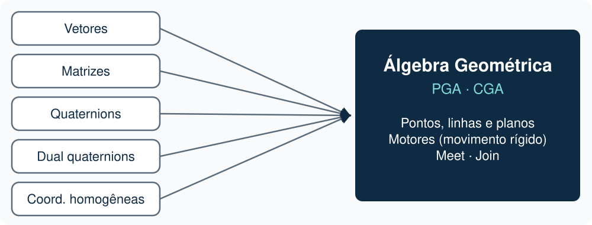
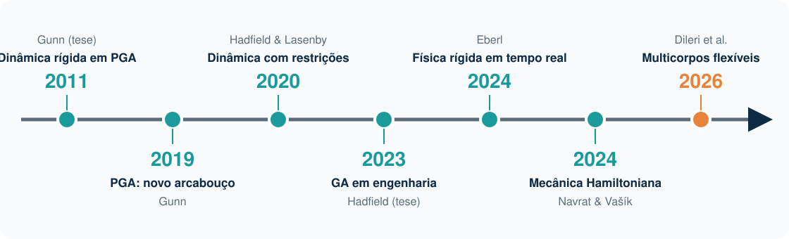
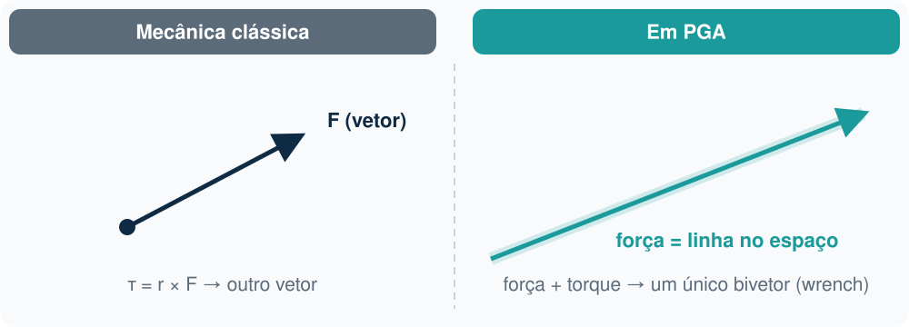
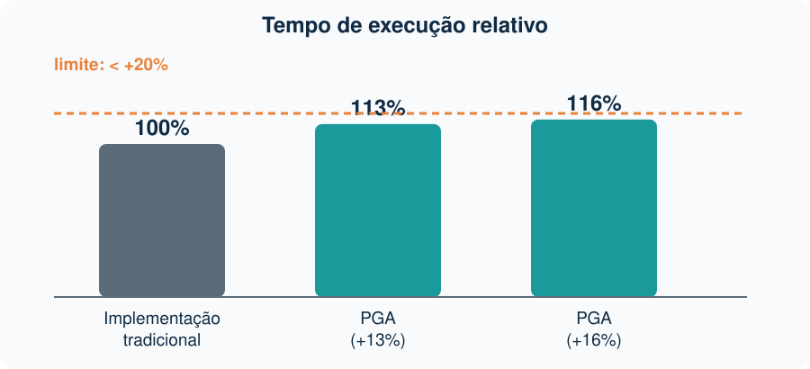
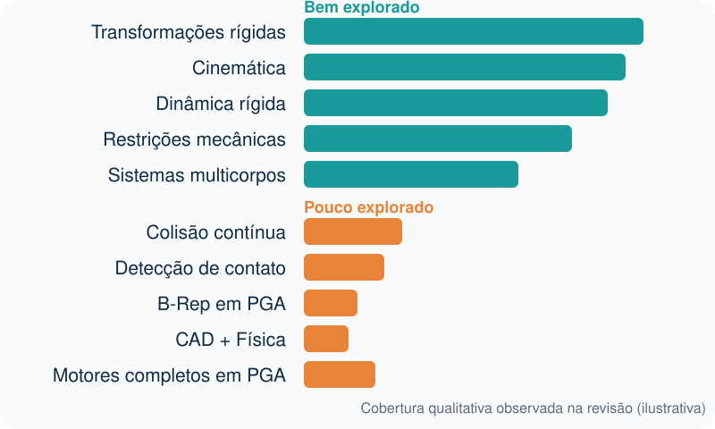
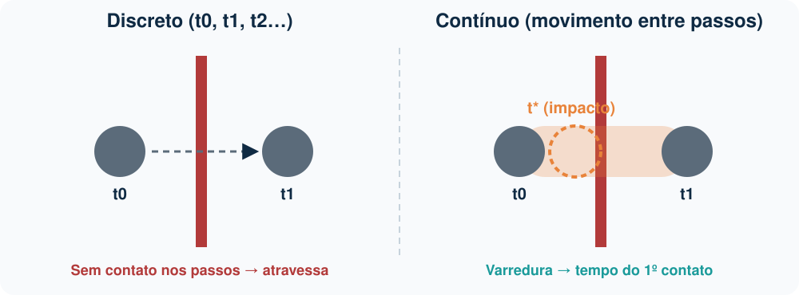
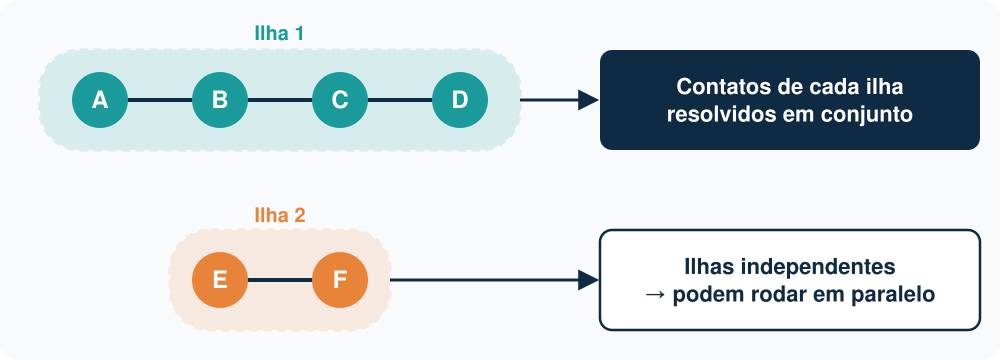

<!-- _class: titulo -->

# Estado da Arte em Simulação Física Baseada em Álgebra Geométrica

## Revisão da literatura recente (2020–2026)

---

# O Problema



Motores físicos modernos normalmente utilizam:

- Álgebra linear
- Matrizes
- Quaternions
- Dual quaternions
- Coordenadas homogêneas

A Álgebra Geométrica propõe unificar todas essas representações em uma única estrutura matemática.

---

# Pergunta Principal

A Álgebra Geométrica pode servir como base para simuladores físicos modernos?

Mais especificamente:

- Representação geométrica
- Cinemática
- Dinâmica
- Restrições
- Sistemas multicorpos
- Tempo real

podem ser tratados dentro de uma mesma estrutura?

---

# Situação Atual da Área

A área ainda é pequena.

A maior parte da literatura recente está concentrada principalmente em duas linhas:

- PGA (Projective Geometric Algebra)
- Dinâmica e restrições em CGA/PGA

A comunidade de pesquisa ainda é relativamente reduzida quando comparada à literatura tradicional de motores físicos.

---

# Evolução da Literatura

```text
Geometria
      ↓

Transformações
      ↓

Cinemática
      ↓

Dinâmica
      ↓

Restrições
      ↓

Tempo Real
      ↓

Multicorpos
      ↓

Corpos Flexíveis
```

---

# Linha do Tempo



---

# Principais Grupos de Pesquisa

## Charles Gunn

Foco:

- Projective Geometric Algebra
- Screw Theory
- Motores geométricos
- Mecânica rígida

A maior parte dos trabalhos recentes em PGA deriva dessa linha.

---

# Principais Grupos de Pesquisa

## Grupo de Cambridge

Pesquisadores:

- Joan Lasenby
- Hugo Hadfield

Foco:

- Dinâmica rígida
- Sistemas multicorpos
- Restrições mecânicas
- Aplicações de CGA e PGA

---

# Trabalho Revisado 1

## Projective Geometric Algebra:
## A New Framework for Doing Euclidean Geometry

Charles Gunn

2019

---

# O Que o Trabalho Faz

Propõe a PGA como uma estrutura unificada para:

- Pontos
- Linhas
- Planos
- Rotações
- Translações
- Movimentos rígidos

---

# Contribuição

O artigo não é sobre simulação física diretamente.

Porém fornece a infraestrutura matemática utilizada praticamente por toda a literatura posterior.

---

# Resultado

Passa a existir uma representação geométrica única para:

```text
Geometria
      +
Transformações
      +
Movimento Rígido
```

---

# Importância

É o trabalho que estabelece a base da PGA moderna.

Sem ele praticamente não existe a linha recente de pesquisa em simuladores físicos baseados em PGA.

---

# Trabalho Revisado 2

## Constrained Dynamics in Conformal and Projective Geometric Algebra

Hugo Hadfield

Joan Lasenby

2020

---

# O Problema

Representar sistemas mecânicos com restrições.

Exemplos:

- Juntas
- Articulações
- Vínculos
- Forças de reação

---

# Principal Contribuição

Representa:

- Forças
- Torques
- Momentos
- Restrições

como objetos geométricos dentro da álgebra.

---

# O Que Muda?



Na mecânica tradicional:

```text
Força → Vetor

Torque → Vetor
```

Neste trabalho:

```text
Força → Linha

Torque → Entidade geométrica
```

---

# Importância

Primeira formulação moderna a integrar **restrições mecânicas** à dinâmica em PGA/CGA:

```text
PGA
      +
Dinâmica
      +
Restrições
```

A dinâmica de corpos rígidos em PGA já havia sido formulada por Gunn; o trabalho mostra a equivalência com a sua formulação em CGA e acrescenta o tratamento de restrições.

---

# Limitação

Não aborda:

- Colisão
- Contato
- Broad phase
- Narrow phase

O foco ainda é a formulação matemática.

---

# Trabalho Revisado 3

## Applications of Geometric Algebra in Mathematical Engineering

Hugo Hadfield

2023

---

# O Que é?

Tese de doutorado desenvolvida em Cambridge.

Provavelmente a referência mais completa encontrada durante a revisão.

---

# Temas Abordados

- PGA
- CGA
- Screw Theory
- Dinâmica rígida
- Sistemas multicorpos
- Robótica
- Restrições

---

# Principal Contribuição

Consolida os resultados produzidos pela linha de pesquisa de Cambridge.

---

# Importância

Funciona como uma síntese moderna da área.

É uma das melhores referências para quem deseja iniciar pesquisa aplicada.

---

# Trabalho Revisado 4

## Geometric Algebra in Real Time Rigid Body Physics Engines

Timo Eberl

2024

---

# O Problema

Uma dúvida frequente:

```text
PGA é elegante.

Mas funciona em tempo real?
```

---

# Objetivo

Implementar componentes de um motor físico utilizando:

- Rigid Geometric Algebra
- Pontos
- Linhas
- Planos
- Transformações rígidas

---

# Resultados



Os experimentos mostraram desempenho próximo das abordagens tradicionais.

O custo adicional ficou próximo de:

- 13%
- 16%

dependendo do algoritmo.

---

# Importância

Mostra que o uso de Álgebra Geométrica não é apenas teoricamente interessante.

Também é computacionalmente viável.

---

# Limitação

Ainda está muito distante da complexidade encontrada em motores como:

- Bullet
- PhysX
- Havok

---

# Trabalho Revisado 5

## Hamiltonian Mechanics in Terms of Geometric Algebras

2024

---

# O Problema

Como representar a Mecânica Hamiltoniana dentro da PGA.

---

# Motivação

Grande parte dos simuladores físicos modernos depende de:

- Integração numérica
- Conservação de energia
- Integradores geométricos

---

# Contribuição

Mostra que:

- Hamiltonianos
- Lagrangianos
- Motores
- Dinâmica rígida

podem ser representados utilizando PGA.

---

# Importância

Abre caminho para:

- Integradores geométricos
- Integradores variacionais
- Simulações fisicamente mais consistentes

---

# Trabalho Revisado 6

## Projective Geometric Algebra for Flexible Multibody Dynamics

2026

---

# O Problema

Quase toda a literatura existente trabalha apenas com:

```text
Corpos rígidos
```

---

# Motivação

Problemas reais possuem:

- Deformação
- Elasticidade
- Vibração
- Corpos flexíveis

---

# Principal Contribuição

Expande PGA para:

- Sistemas multicorpos
- Corpos flexíveis
- Dinâmica estrutural

---

# Importância

Representa uma das extensões mais avançadas encontradas durante esta revisão.

Mostra que a comunidade está avançando além dos corpos rígidos.

---

<!-- _class: titulo -->

# Trabalhos Complementares

## Base da dinâmica em PGA e literatura de colisão e contato em computação gráfica

---

# Complementar 1 — Gunn (2011)

## Geometry, Kinematics, and Rigid Body Mechanics in Cayley-Klein Geometries

Tese de doutorado, TU Berlin

- Cinemática e **dinâmica de corpos rígidos** formuladas com álgebras de Clifford
- Corpos rígidos construídos a partir de partículas; o tensor de inércia é representado como uma álgebra de Clifford própria
- Implementação e simulações de movimento rígido

> **Importância:** é a origem da dinâmica rígida em PGA citada por Hadfield & Lasenby (2020), anterior ao artigo de 2019.

---

# Complementar 2 — Dorst & De Keninck (2024)

## Physical Geometry by Plane-Based Geometric Algebra

ICACGA 2022 · Springer Proceedings in Mathematics & Statistics

- Movimento de objetos com massa sob forças e torques, em PGA
- Aspectos lineares e angulares unificados, sem coordenadas
- Mapas de inércia simplesmente **aditivos**
- Equações simples e código numérico direto

> **Relevância:** tratamento atual e didático da dinâmica em PGA, com guia complementar em n dimensões (*May the Forque Be with You*).

---

# Complementar 3 — Colisão Contínua em Corpos Rígidos

| Trabalho | Veículo | Contribuição |
|---|---|---|
| Redon, Kheddar & Coquillart (2002) | Computer Graphics Forum (Eurographics) | Tempo do primeiro contato calculado pelo próprio algoritmo; corpos rígidos poliédricos |
| Brochu, Edwards & Bridson (2012) | ACM Trans. Graphics (SIGGRAPH) | CCD **geometricamente exato**, robusto a erros de arredondamento |
| Wang et al. (2021) | ACM Trans. Graphics | *Benchmark* e algoritmo conservativo baseado em inclusão |

---

# Complementar 3 — O Que Cada Trabalho Traz

- **Redon et al.:** polygon soups, vários corpos em movimento, corpos articulados acíclicos, acoplado a um simulador dinâmico em tempo real
- **Brochu et al.:** nenhum contato perdido nem falso positivo; demonstrado em simulação de tecido
- **Wang et al.:** compara algoritmos de CCD em casos degenerados e comuns; implementação aberta em C++ (Tight-Inclusion)

> Nenhum deles usa PGA: todos partem de vetores e matrizes.

---

# Complementar 4 — Ferguson et al. (2021)

## Intersection-free Rigid Body Dynamics

ACM Transactions on Graphics (SIGGRAPH 2021)

- Primeiro algoritmo **implícito** de integração para corpos rígidos com contato e atrito que garante ausência de interseção a cada passo
- Modela as **trajetórias curvas** dos corpos na detecção e na resposta
- Narrow phase conservativa, reduzida a consultas CCD lineares com separação mínima

> **Limitação:** menos eficiente que alternativas, mas robusto em cenas complexas.

---

# O Que Isso Muda na Lacuna?

- Colisão contínua e contato são **maduros** em computação gráfica
- Na literatura de **GA/PGA** revisada, não apareceu formulação de colisão contínua nem de B-Rep
- A lacuna é a **integração**: colisão contínua + contato dentro do formalismo da PGA

> **Hipótese a investigar:** sobre um passo de tempo, o movimento de um corpo é um movimento helicoidal (*screw motion*), natural para motores da PGA.

---

# Evolução Observada

A literatura recente evoluiu aproximadamente da seguinte forma:

```text
Geometria
      ↓

Transformações
      ↓

Cinemática
      ↓

Dinâmica
      ↓

Restrições
      ↓

Tempo Real
      ↓

Multicorpos
      ↓

Corpos Flexíveis
```

---

# O Que Já Está Bem Desenvolvido?

- PGA
- Transformações rígidas
- Screw Theory
- Cinemática
- Dinâmica rígida
- Restrições mecânicas
- Sistemas multicorpos

---

# O Que Ainda Tem Poucos Trabalhos em GA/PGA?

Durante a revisão da literatura de GA/PGA apareceram poucos resultados em:

- Colisão
- Detecção de contato
- Continuous Collision Detection
- B-Rep
- Modelagem sólida
- CAD + Física
- Motores físicos completos

---

# Principal Lacuna Encontrada



A literatura avançou em:

```text
Representação
      ↓

Cinemática
      ↓

Dinâmica
```

Mas avançou pouco em:

```text
Colisão
      ↓

Contato
      ↓

Modelagem Sólida
```

---

# Proposta Inicial


Investigar o uso de PGA para aproximar:

```text
Geometria
      +
Colisão
      +
Dinâmica
```

dentro de uma única estrutura matemática.

---

# Direção Proposta

Representar sólidos utilizando:

- Faces
- Arestas
- Vértices

seguindo um modelo B-Rep.

---

# Ideia Principal



Ao invés de analisar apenas:

```text
Posição em t0

Posição em t1
```

investigar o movimento contínuo durante o intervalo.

---

# Hipótese

A detecção de colisão poderia considerar simultaneamente:

- Tempo
- Velocidade linear
- Velocidade angular
- Geometria das faces

permitindo representar a varredura dos objetos durante o movimento.

---

# Tratamento dos Contatos



Após detectar contatos:

```text
A ↔ B ↔ C ↔ D
```

os objetos seriam agrupados em:

## Ilhas de Colisão

---

# Resolução

Investigar a resolução simultânea dos contatos de uma mesma ilha.

Possíveis vantagens:

- Melhor estabilidade
- Menor dependência da ordem dos contatos
- Paralelização natural

---

# Conclusão

A literatura recente demonstra que:

- PGA tornou-se o principal formalismo geométrico da área;
- Dinâmica rígida baseada em Álgebra Geométrica é viável;
- Sistemas multicorpos já estão sendo explorados;
- Implementações em tempo real são possíveis.

---

# Conclusão

As principais oportunidades de pesquisa identificadas são:

- Colisão contínua
- Detecção de contato
- Modelagem B-Rep
- Integração CAD + Física
- Motores físicos completos em PGA

A proposta apresentada se posiciona exatamente nessa região ainda pouco explorada da literatura de Álgebra Geométrica.

---

# Referências

GUNN, Charles. *Projective Geometric Algebra: A New Framework for Doing Euclidean Geometry*. 2019.

HADFIELD, Hugo; LASENBY, Joan. *Constrained Dynamics in Conformal and Projective Geometric Algebra*. 2020.

HADFIELD, Hugo. *Applications of Geometric Algebra in Mathematical Engineering*. PhD Thesis, University of Cambridge. 2023.

EBERL, Timo. *Geometric Algebra in Real Time Rigid Body Physics Engines*. 2024.

NAVRAT, Aleš; VAŠÍK, Petr. *Hamiltonian Mechanics in Terms of Geometric Algebras*. 2024.

DILERI, Eirini; EBEL, Henrik; BAUCHAU, Olivier. *Projective Geometric Algebra for Flexible Multibody Dynamics*. 2026

---

# Referências — Complementares

GUNN, Charles. *Geometry, Kinematics, and Rigid Body Mechanics in Cayley-Klein Geometries*. PhD Thesis, Technische Universität Berlin. 2011.

DORST, Leo; DE KENINCK, Steven. *Physical Geometry by Plane-Based Geometric Algebra*. In: Advanced Computational Applications of Geometric Algebra (ICACGA 2022). Springer, 2024. p. 43–76.

REDON, Stéphane; KHEDDAR, Abderrahmane; COQUILLART, Sabine. *Fast Continuous Collision Detection between Rigid Bodies*. Computer Graphics Forum, v. 21, n. 3, p. 279–287, 2002.

BROCHU, Tyson; EDWARDS, Essex; BRIDSON, Robert. *Efficient Geometrically Exact Continuous Collision Detection*. ACM Transactions on Graphics, v. 31, n. 4, 2012.

WANG, Bolun et al. *A Large-scale Benchmark and an Inclusion-based Algorithm for Continuous Collision Detection*. ACM Transactions on Graphics, v. 40, n. 5, 2021.

FERGUSON, Zachary et al. *Intersection-free Rigid Body Dynamics*. ACM Transactions on Graphics, v. 40, n. 4, 2021.
